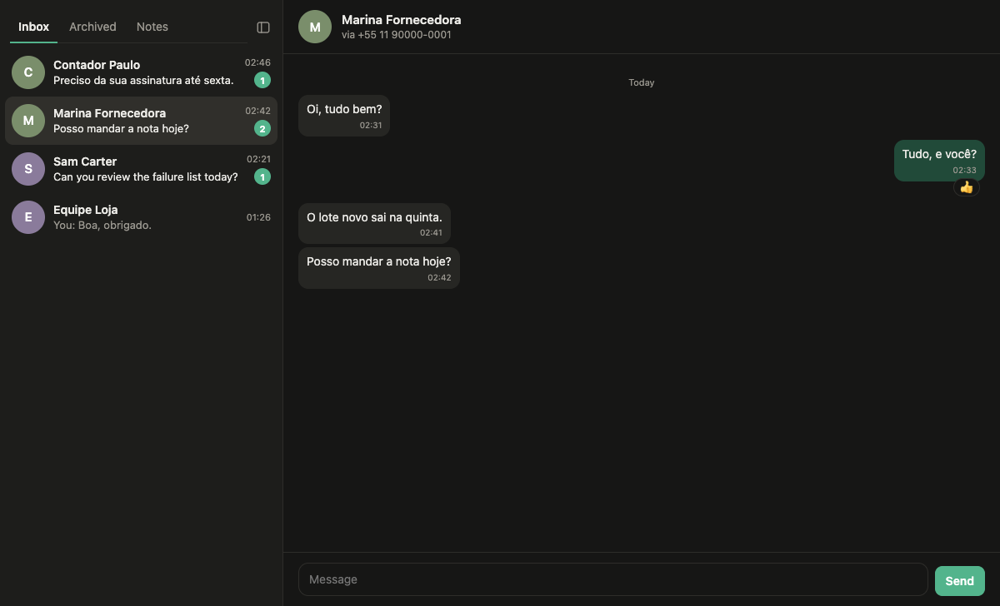
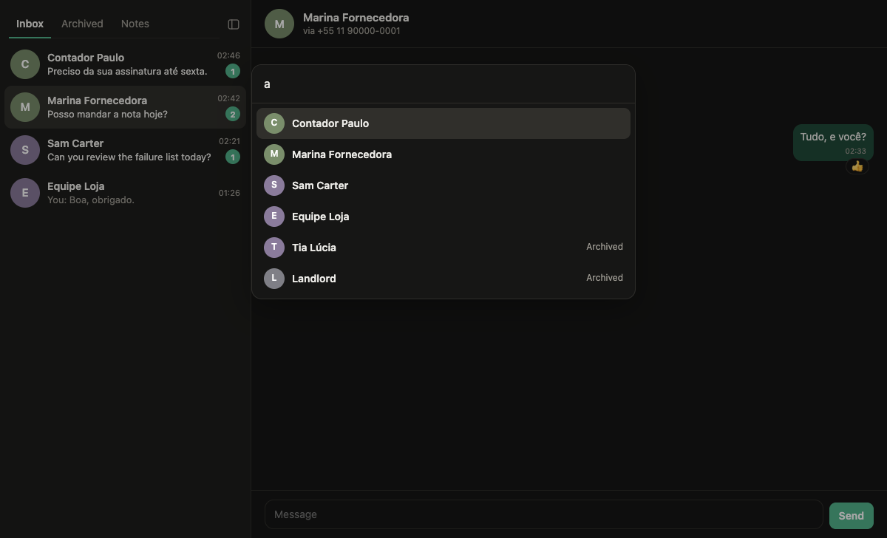
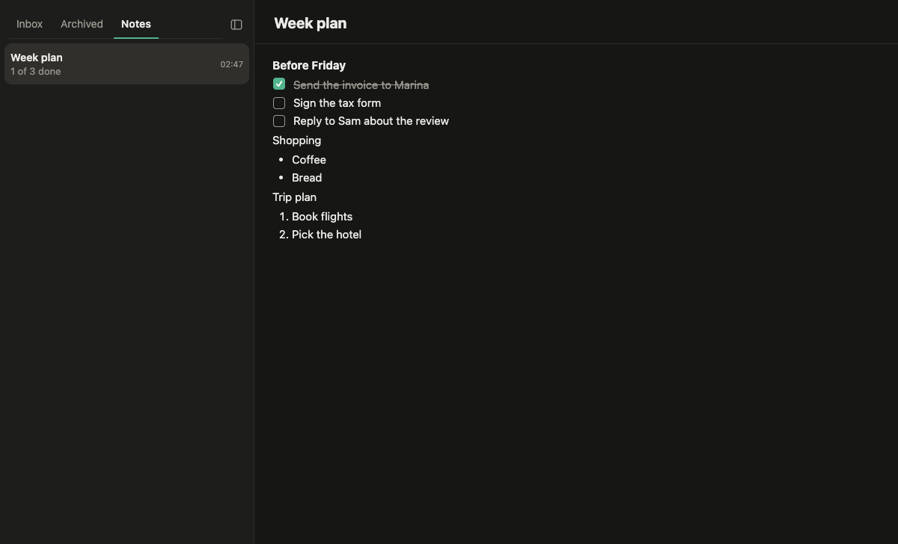

<p align="center"></p>

<h1 align="center">Whatsapp Central</h1>

<p align="center">Two WhatsApp numbers in one Mac app. One inbox. Your messages stay on your Mac.</p>



## Why

I have two WhatsApp numbers, one from Brazil and one from the US. I used to keep two windows open. This app links both numbers by QR code and shows every chat in one list.

The rule I care about most: archived chats stay out of sight. When a new message arrives in an archived chat, the chat moves back to the inbox. Everything else stays archived.

## Features

- **One inbox for two numbers.** Link each number with a QR code, like WhatsApp Web.
- **Auto-unarchive.** A new message in an archived chat brings it back to the inbox. Archiving here also archives on the phone.
- **Keyboard first.** `E` archives the open chat and opens the next one. `↑` and `↓` move between chats. `⌘K` finds any chat, archived or not.
- **Messages.** Read and send text. Photos, videos, stickers, documents and voice messages play inside the app. Old media that WhatsApp no longer stores is requested again from your phone.
- **Reactions.** See reactions and react with one click.
- **Profile photos**, cached on your Mac and checked again every 7 days.
- **Notes.** A third tab for your own notes, with bold text, bullet lists, numbered lists and to-do lists. Type `/` for the menu, or select text for a small format bar. `⌘N` creates a note.
- **Unread count** on the Dock icon and macOS notifications for new messages.
- **Resizable sidebar.** Drag its edge, or hide it with `⌘\`.

| Find any chat with ⌘K | Notes with to-do lists |
| --- | --- |
|  |  |

## Privacy

- Messages, media, profile photos and login keys are stored only on your Mac, in `~/Library/Application Support/WhatsCentral`.
- The app connects straight to WhatsApp's servers. There is no server of mine in the middle.
- The app's window talks to a small local server on `127.0.0.1:4319`. That server refuses requests from other computers, from other websites, and from any page without a secret created each time the app starts.

## Read this before you use it

- **This is not an official WhatsApp app** and is not affiliated with WhatsApp or Meta.
- It uses [Baileys](https://github.com/WhiskeySockets/Baileys), an unofficial library that links as a "linked device", the same way WhatsApp Web does.
- WhatsApp's terms allow it to restrict accounts that use unofficial apps. Test with the number you care about least first.

## Requirements

- A Mac with Apple Silicon (M1 or newer). I only built and tested on macOS with Apple Silicon.
- [Node.js](https://nodejs.org) 22.5 or newer (the app uses the built-in `node:sqlite`).

## Install and run

```bash
git clone https://github.com/renantrendt/whatsapp-central.git
cd whatsapp-central
npm install
```

Build the Mac app and open it:

```bash
npm run package
```

```bash
open "dist/Whatsapp Central-darwin-arm64/Whatsapp Central.app"
```

You can drag the app from `dist/` to your Applications folder.

To link a number: menu **Whatsapp Central > Connect New Account…**, then on the phone open WhatsApp > Settings > Linked devices > Link a device, and scan the code. Repeat for the second number.

### Other commands

| Command | What it does |
| --- | --- |
| `npm run app` | Opens the app from the source code, without packaging. |
| `npm run demo` | Runs the interface with fake chats on `http://127.0.0.1:4319`. No WhatsApp account needed. |
| `npm run screenshots` | Rebuilds the images in `docs/screenshots/` from the demo data. |
| `bash build/make-icon.sh <file.svg>` | Rebuilds the app icon from an SVG. |

## Shortcuts

| Key | Action |
| --- | --- |
| `E` | Archive or unarchive the open chat |
| `↑` `↓` | Previous or next chat |
| `⌘K` | Find a chat |
| `⌘N` | New note |
| `⌘\` | Hide or show the sidebar |
| `/` in a note | Menu for lists, to-dos and bold |
| `⌘B` in a note | Bold |

## How it is built

| Folder | What is inside |
| --- | --- |
| `electron/` | The Mac window and the app menu. |
| `server/` | The local server: WhatsApp connection (`wa.js`), the archive rules (`hub.js`), the SQLite database (`store.js`) and the demo data (`demo.js`). |
| `ui/` | The interface: plain HTML, CSS and JavaScript, no framework. |
| `build/` | The app icon and the logo options. |

## License

[MIT](LICENSE)
